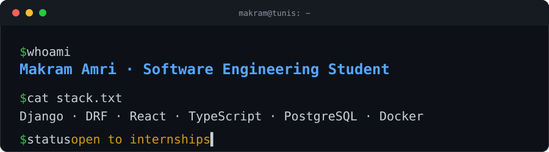

<p align="center">
  
</p>

<p align="center">
  <a href="https://makramamriportfolio.vercel.app/"></a>
  <a href="mailto:makremamri08@gmail.com"></a>
  <a href="https://www.linkedin.com/in/amri-makrem/"></a>
</p>

```python
class Makram:
    role     = "Software Engineering student @ Université Sesame, Tunis"
    builds   = ["multi-tenant SaaS", "REST APIs", "applied AI"]
    backend  = ["Python", "Django", "DRF", "PostgreSQL", "Celery"]
    frontend = ["React", "TypeScript", "Tailwind"]
    ships    = ["Docker", "GitHub Actions", "Linux"]
    leads    = "IEEE RAS student chapter @ SESAME"
    status   = "open to internships and junior developer roles"
```

## Featured work

| Project | What it is | Stack |
| :-- | :-- | :-- |
| **[Nexus](https://github.com/Ing-Makram/Nexus)** | Multi-tenant SaaS for business operations. Tenant isolation enforced in the query layer, role-based access, 480 tests. [Case study](https://makramamriportfolio.vercel.app/) | Django · DRF · PostgreSQL · React · TypeScript · Docker |
| **[AI-CV-Internship-Matcher](https://github.com/Ing-Makram/AI-CV-Internship-Matcher)** | AI chatbot that analyzes student CVs and recommends internships, events, and university resources. | TypeScript · AI |
| **[Ecommerce-Web-App](https://github.com/Ing-Makram/Ecommerce-Web-App)** | Django REST API for products, providers, clients, and orders. | Python · Django · DRF |
| **[NutriScan](https://github.com/Ing-Makram/NurtriScan-AI-Calories-Tracker)** | Prototype: food photo classification and calorie tracking. | TensorFlow · Celery · GraphQL |

More projects and write-ups on the [portfolio](https://makramamriportfolio.vercel.app/).

## Toolbox


## Get in touch

I'm looking for an internship. The fastest way to reach me is [makremamri08@gmail.com](mailto:makremamri08@gmail.com) or [LinkedIn](https://www.linkedin.com/in/amri-makrem/).
